<div align="center">

<picture>
  <source media="(prefers-color-scheme: dark)" srcset=".github/assets/banner-dark.svg">
  
</picture>

**Credentials belong in the device vault, not in application storage.**<br>
Build secure sessions and OAuth 2.1/PKCE flows with Android Keystore and Apple Keychain primitives, biometric unlock and screen privacy, exposed through strict PHP APIs.

[](https://packagist.org/packages/pushinbr/pam-native-auth)
[](https://github.com/push-in/pam-native-auth/releases/latest)

[](https://github.com/push-in/pam-native-auth/actions/workflows/ci.yml)
[](LICENSE)

[Install](#install) · [Quick example](#quick-example) · [Platforms](#platform-support) · [Permissions](#requirements) · [Docs](#docs) · [Issues](https://github.com/push-in/pam-native-auth/issues)

</div>

<a id="install"></a>
## <picture></picture> Install

Inside a PAM Native project, add only this capability:

```sh
pam composer require pushinbr/pam-native-auth
pam doctor --fix
```

Composer updates the normal `composer.json` and `composer.lock`; `pam doctor --fix` refreshes the generated native integration when required. Use `pam packages` to list direct requirements and `pam composer remove pushinbr/pam-native-auth` to uninstall. New to PAM? Create a project with `pam init my-app --template native` (see the [PAM Native overview](https://push-in.github.io/pam-docs/native/overview/)), then come back here.

<a id="quick-example"></a>
## <picture></picture> Quick example

```php
<?php

use Pam\Native\Auth\AuthVault;
use Pam\Native\Auth\Pkce;

$pkce = Pkce::generate(); // Send $pkce->challenge to your OAuth 2.1 authorization server.

(new AuthVault())->store('session.refresh-token', $refreshToken, function ($state, $error): void {
    // AuthOperationState is an integer-backed enum.
});
```

The vault uses AES-256-GCM with a non-exportable Android Keystore key. On Apple platforms it uses a generic-password Keychain item and defaults to `WhenUnlockedThisDeviceOnly`. PKCE uses SHA-256 (`S256`) and a cryptographically random verifier.

Do not store user passwords. Store short-lived sessions or refresh tokens, rotate them server-side, and delete the local credential on logout or revocation.

<a id="platform-support"></a>
## <picture></picture> Platform support

| Platform | Support | Notes |
| --- | --- | --- |
| Android | API 26+ (Android 8.0) | Android Keystore + AES-GCM; `androidx.biometric` 1.1.0 |
| iOS | 15.0+ | Security.framework Keychain, LocalAuthentication |
| PAM Native | 0.8.0 to < 2.0.0 | From `pam-native.plugin.json`; plugin protocol 1; current native certification uses SDK `1.0.16`; PHP 8.5+ |

<a id="requirements"></a>
## <picture></picture> Permissions and requirements

| Platform | Declared by the plugin |
| --- | --- |
| Android | `android.permission.USE_BIOMETRIC`, `android.permission.USE_FINGERPRINT` |
| iOS | `NSFaceIDUsageDescription` ("Authenticate to unlock your account.") |

Platform SDKs, credentials, entitlements, physical hardware and store configuration remain application responsibilities. Passkeys and interactive OAuth authorization are deliberately separate from the vault because they require an app presentation context, associated domains and server-side challenge verification. Those flows will be added only with end-to-end app lifecycle support.

<a id="what-you-can-build"></a>
## <picture></picture> What you can build

- Encrypted refresh-token and session storage
- OAuth 2.1 authorization-code flows with PKCE
- Logout, revocation and credential-rotation workflows
- Biometric unlock and concealed content after backgrounding

| | |
| --- | --- |
| **Native path** | Android Keystore · Apple Keychain |
| **Application model** | Composer package + generated native integration |
| **Design rule** | Independent module; no feed, vertical or application template bundled |

<a id="api-guide"></a>
## <picture></picture> API guide

| API | Responsibility |
| --- | --- |
| `Biometrics` | Check availability and request system biometric authentication. |
| `ScreenPrivacy` | Conceal protected content until the application explicitly authorizes reveal. |
| `AuthVault` | Store, check, retrieve and delete encrypted secrets; `exists()` never returns secret material. |
| `Pkce` / `PkcePair` | Generate and verify OAuth 2.1 S256 PKCE material. |
| `CredentialAccessibility` | Choose the native credential accessibility policy. |
| `AuthOperationState` | Typed result state for vault operations. |

All coded states, kinds and variants are sequential integer-backed enums. Use enum cases in application code; do not depend on raw wire numbers.

<a id="biometric-unlock-and-screen-privacy"></a>
## <picture></picture> Biometric unlock and screen privacy

`Biometrics` uses strong Android biometrics and biometric-only Apple LocalAuthentication. Results are explicit integer-backed enums; cancellation, unavailability, lockout, failure and concurrent requests never report authentication success.

`ScreenPrivacy` keeps content covered after backgrounding until the application explicitly calls `reveal`. Android also blocks screenshots on the protected Activity and conceals accessibility content. iOS covers inactive scene windows; it does not prevent screenshots.

These primitives do not implement an application session gate or cryptographically bind vault retrieval to biometric authentication. Gate credential access, request dispatch and navigation together; validate session expiry and revocation with your backend before revealing private content.

<a id="production-checklist"></a>
## <picture></picture> Production checklist

- Keep access tokens short-lived and rotate refresh tokens server-side.
- Delete credentials on logout, revocation or account removal.
- Never log secrets, verifiers, authorization codes or token responses.
- Run `pam doctor`, `pam test` and a signed release build on every supported platform.
- Exercise denial, cancellation, backgrounding, process restart and offline behavior before release.

Security vulnerabilities should be reported through the repository security policy or GitHub private vulnerability reporting, not a public issue.

<a id="troubleshooting"></a>
## <picture></picture> Troubleshooting

- **Vault callbacks fail:** confirm the app is active and inspect the callback error.
- **OAuth challenge mismatch:** preserve the exact verifier until the authorization callback.
- **Credentials disappear after reinstall:** device-only storage is intentionally app-scoped.
- **Native integration is stale:** run `pam doctor --fix`, rebuild the native host, and inspect the first reported diagnostic.

<a id="docs"></a>
## <picture></picture> Docs

- [PAM Native overview](https://push-in.github.io/pam-docs/native/overview/)
- [PAM introduction](https://push-in.github.io/pam-docs/introduction/)
- [Biometrics API](docs/biometrics.md)
- [Screen privacy API and lifecycle](docs/screen-privacy.md)
- [Native validation evidence and limitations](docs/native-validation.md)
- [Plugin lifecycle compatibility](docs/plugin-lifecycle-compatibility.md)
- [Plugin and native capability model](https://push-in.github.io/pam-docs/native/plugins/)
- [Changelog](CHANGELOG.md)
- [Report an issue](https://github.com/push-in/pam-native-auth/issues)

<a id="pam-ecosystem"></a>
## <picture></picture> Part of the PAM ecosystem

<p align="center"><picture>
  <source media="(prefers-color-scheme: dark)" srcset=".github/assets/pam-wordmark-dark.svg">
  
</picture></p>

PAM runs PHP natively on servers, desktops and phones. This repository is one piece of it.

| [**PAM**](https://github.com/push-in/pam) | [**PAM Desktop**](https://github.com/push-in/pam-desktop) | [**PAM Native**](https://github.com/push-in/pam-native) | [**Ecosystem**](https://github.com/push-in/pam#ecosystem) |
| --- | --- | --- | --- |
| the runtime and CLI | native desktop apps in PHP | native Android and iOS apps in PHP | every official package and plugin |

<sub>Docs: [push-in.github.io/pam-docs](https://push-in.github.io/pam-docs/introduction/) · [Issues](https://github.com/push-in/pam-native-auth/issues)</sub>

<p align="center"><sub><a href="LICENSE">Apache License 2.0</a> · Made in Brazil by Pushin</sub></p>
